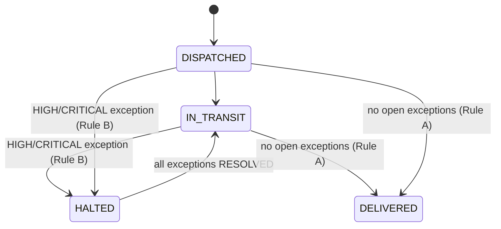

# Dispatch Exception CoPilot

Turn chaotic, real-world courier exception updates (often written in **Arabizi /
mixed Arabic-English**) into strict, actionable business operations.

This project is a teaching artifact: it demonstrates the difference between
"logging a string" and **engineering a strict state machine** with enforced
business rules and a complete audit trail.

## Tech Stack

| Concern        | Choice                                   |
| -------------- | ---------------------------------------- |
| Framework      | Next.js (App Router, Server Actions)     |
| Database       | PostgreSQL + Prisma ORM                  |
| State (client) | Zustand                                  |
| UI             | Tailwind CSS + Shadcn-style components    |
| Deployment     | Docker (standalone output), Railway-ready |

## The State Machine



### Enforced business rules

- **Rule A** — A `Shipment` cannot become `DELIVERED` while any `Exception` is
  in `TRIAGE` or `ACTIONING`.
- **Rule B** — Creating a `HIGH` or `CRITICAL` `Exception` automatically forces
  the parent `Shipment` to `HALTED`.
- **Rule C** — Every status change (shipment or exception) writes an `AuditLog`
  row with `oldState`, `newState`, and `action`.

All rules are enforced inside transactional [Server Actions](src/app/actions) so
an audit entry can never be orphaned from the change it describes.

## Project layout

```
prisma/
  schema.prisma          Strict taxonomy (enums) + models
  seed.ts                15+ Lebanese shipments incl. active exceptions
src/
  app/
    actions/             Server Actions (business rules A/B/C live here)
    layout.tsx, page.tsx Server component fetches initial data
  components/
    copilot/             Analyze → 3-card triage → approve/fallback
    dashboard/           Color-coded table, badges, audit feed
    ui/                  Shadcn-style primitives
  lib/
    mock-ai.ts           Simulated AI (2.5s delay; "fail" → error)
    db.ts, types.ts, utils.ts
  store/
    use-dispatch-store.ts  Zustand store
Dockerfile, docker-entrypoint.sh, railway.toml   Container + Railway deploy
```

> This app is one of two services in the monorepo. The root
> [`docker-compose.yml`](../docker-compose.yml) orchestrates it together with
> the database and the [`ai-service`](../ai-service/); see the
> [monorepo README](../README.md) and [integration guide](../docs/INTEGRATION.md).

## Local development

### 1. Start PostgreSQL

```bash
docker compose up -d db      # run from the repo root (compose lives there)
```

This exposes Postgres on `localhost:5433` (mapped to the container's 5432, to
avoid clashing with any Postgres already on 5432) with credentials matching
[.env](.env).

### 2. Install dependencies

```bash
npm install
```

### 3. Apply the schema and seed data

```bash
npm run db:migrate      # creates the migration + tables
npm run db:seed         # 15+ shipments, a few active exceptions
```

### 4. Run the app

```bash
npm run dev
```

Open http://localhost:3000.

## Using the CoPilot

1. In the right-hand **Exception CoPilot**, pick a shipment and paste a raw
   update (try the sample chips).
2. Click **Analyze** — a 2.5s skeleton shows while the mock AI "thinks".
3. Review the three cards (Structured Record, Action Plan, Customer
   Notification) and click **Approve & Execute** to commit.
4. If the update contains the word **`fail`**, the AI throws and the UI drops
   into **Fallback Mode** — a manual form to build the record by hand.

The left dashboard polls every 5s, so HALTED/DELIVERED badge changes and new
audit-feed entries appear automatically.

### Try the rules

- **Rule B**: analyze a `HIGH`/`CRITICAL` update (e.g. mentions "accident") and
  approve → the shipment flips to **HALTED**.
- **Rule A**: try **Deliver** on a shipment with an open exception → blocked
  with an explanation.
- **Rule C**: every action appears in the **Audit Activity** feed.

## Docker

### Full stack with compose

The root [`docker-compose.yml`](../docker-compose.yml) builds and runs this app
alongside Postgres and the `ai-service`. From the **repo root**:

```bash
# Build + run db, ai-service, and this app together
docker compose up --build

# Seed the containerized database (one-off, uses the builder image)
docker compose --profile seed run --rm seed
```

The app container runs `prisma migrate deploy` on startup
(see [docker-entrypoint.sh](docker-entrypoint.sh)) and serves the
standalone Next.js build on port 3000.

### Deploying to Railway

1. Create a new Railway project and add the **PostgreSQL** plugin — Railway
   injects `DATABASE_URL` automatically.
2. Deploy this repo with the provided [Dockerfile](Dockerfile) (Railway detects
   it). Migrations run automatically at container start.
  - Ensure the service is using the repo [railway.toml](railway.toml) + Dockerfile.
  - In service settings, keep **Start Command** empty so Docker image defaults are used
    (the image [ENTRYPOINT](docker-entrypoint.sh) runs migrations before boot).
3. To seed once after the first deploy, run a one-off command in the Railway
   shell:
   ```bash
   npx prisma db seed
   ```
   (or set `SEED_ON_START=true` on the service for an auto-seed attempt).

## AI Integration

The AI analysis runs as a **separate Python service** in [`../ai-service/`](../ai-service/)
(FastAPI + OpenAI), implementing the HTTP contract in
[AI_INTEGRATION.md](AI_INTEGRATION.md). Run it:

```bash
cd ../ai-service
python3 -m venv .venv && source .venv/bin/activate   # first time only
pip install -r requirements.txt                       # first time only
cp .env.example .env                                  # set OPENAI_API_KEY + AI_SERVICE_API_KEY
uvicorn app.main:app --reload --port 8000
```

It serves `POST /v1/exceptions:analyze` on http://localhost:8000 (docs at `/docs`,
health at `/healthz`). Without an `OPENAI_API_KEY` it falls back to a deterministic
keyword classifier, so it runs with no external dependencies.

To point this app at it, set `AI_SERVICE_URL` (and the matching
`AI_SERVICE_API_KEY`) in [`.env`](.env.example) — the `analyzeExceptionText`
seam then calls the service instead of the built-in mock. Leaving `AI_SERVICE_URL`
unset keeps the mock, so local dev stays network-free. See
[../ai-service/README.md](../ai-service/README.md) and
[../docs/INTEGRATION.md](../docs/INTEGRATION.md) for the full contract and config.
## Testing

```bash
npm test                  # unit tests (mock AI classifier) — no DB needed
npm run test:integration  # real state-machine test against Postgres
```

The integration test exercises Rules A/B/C end-to-end against a real
database, so it needs `docker compose up -d db` (+ migrations applied)
running locally first. It creates and deletes its own throwaway shipment —
never point it at a production `DATABASE_URL`.

CI ([`.github/workflows/ci.yml`](../.github/workflows/ci.yml)) runs both: a fast
`web-app` job (lint + typecheck + unit) on every push, and a
`web-app-integration` job with an ephemeral Postgres service container. A
separate `ai-service` job runs the Python tests.

## How this was built

This project is a teaching artifact, and the full sequence of design
decisions — why Server Actions instead of a separate API, why the state
machine looks the way it does, why the AI is mocked behind a seam, why the
testing/CI setup is split the way it is — is written up as a numbered
decision log in [`docs/decisions/`](docs/decisions/README.md). Read it in
order; it's structured as a build narrative, not a reference doc.

## Notes

- The Prisma schema is intentionally fixed by the exercise. The AI's
  `etaImpact` value is folded into the persisted action plan / notification text
  rather than adding a column.
- `src/lib/mock-ai.ts` is the single seam to swap in a real model later — the
  `analyzeExceptionText` contract and `AnalysisResult` shape are what the rest
  of the app depends on. See [`AI_INTEGRATION.md`](AI_INTEGRATION.md) for the
  full contract and integration checklist.
